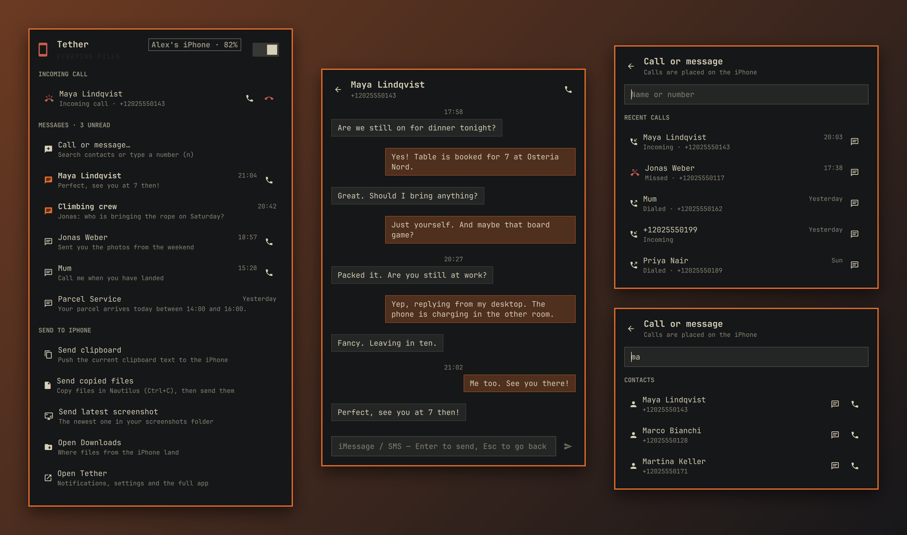

# Omatinuity

A bar widget for [Tether](https://github.com/zackb/tether), iPhone ↔ Linux continuity in the
Omarchy bar: read and reply to messages, answer and place calls, accept pairing requests, and
send the clipboard, copied files or the latest screenshot to the phone.

Built to the Omarchy plugin contract (<https://plugins.omarchy.org/develop.html>): one
`bar-widget` kind, `BarWidget.qml` as the entry point, and `Panel.qml` loaded by it.

<p align="center">
  
</p>

Single views: [overview](screenshots/overview.png) ·
[conversation](screenshots/conversation.png) ·
[incoming call](screenshots/incoming-call.png) ·
[recent calls](screenshots/recent-calls.png) ·
[contact search](screenshots/contacts.png) ·
[pairing request](screenshots/pairing.png).
The people, numbers and messages in the pictures are made up.

## Files

```
io.github.sgatter.omatinuity/
├── manifest.json        bar-widget, entry point BarWidget.qml
├── BarWidget.qml        bar icon, Tether service, panel lifecycle, shell IPC
├── Panel.qml            details panel (KeyboardPanel, keyboard navigation)
├── Service.qml          state, polling and actions (shared by icon and panel)
├── TextEntry.qml        the reply and dialer text box (see Security)
├── backend.py           talks to tetherd over $XDG_RUNTIME_DIR/tether/tetherd.sock
├── bin/tether-gtk       notification-click redirect (see below)
├── setup-bluetooth.sh   one-time Bluetooth setup for messages and calls
├── preview.png          picture for this page and the marketplace listing
├── screenshots/         the single views it is made of
└── tests/               regression tests for the rules under Security
```

## Dependencies

- An iPhone with the [Tether app](https://apps.apple.com/us/app/tether-linux-companion/id6762097135),
  version 1.4.2 or later, on the same Wi-Fi as the computer.
- [Tether](https://github.com/zackb/tether) on the computer, version 0.2.35 or later (tested
  with 0.3.5). Both minimums are the releases that fix Tether's published security advisories.
- `python3` with `python-gobject`, and `wl-clipboard`. Both ship with Omarchy.

Tether is a separate project by a different author, with its own code, releases and security
policy. This plugin is only a front end for it: it does not download, install or update Tether.
You do, from the AUR, where it comes in two packages by Tether's author (there is no package
called plain `tether`):

- `tether-bin` installs the binaries of a tagged release, pinned by checksum.
- `tether-git` builds whatever is on Tether's main branch on the day you install it.

## What it does with your data

None of this is hidden, but it is more than a bar icon suggests, so read it before you enable it.

**Tether, whenever `tetherd` runs** (these are its defaults; its own settings change them):

- listens on TCP port 5134 on every network interface and announces itself over mDNS;
- shares the clipboard both ways with every connected paired device, automatically: everything
  you copy, passwords included. "Share the clipboard automatically" in Tether's settings turns
  that off;
- saves files a paired device sends into `~/Downloads` without asking for each one, and opens
  links a paired device sends in your browser;
- with the Bluetooth setup: shows the iPhone's notifications on the desktop, keeps an encrypted
  copy of messages and contacts in `~/.local/share/tether`, and looks for one-time codes in
  incoming messages;
- writes a log, `~/.local/state/tether/tetherd.log`, that is never rotated and names devices,
  addresses and the numbers you send messages to. This plugin asks `tetherd` for its state
  every ten seconds, and every question adds lines to that log. `: > ~/.local/state/tether/tetherd.log`
  empties it.

**Pairing** gives a device all of that. Any device on the network can ask to pair and can call
itself anything, so pair only when you have just asked for it from your own iPhone.

**This plugin**, on top:

- Opening a conversation marks its messages as read on the iPhone. So does replying. That also
  holds when a notification click or a shell command opens the conversation.
- A reply is sent from your number, as an SMS or iMessage. `dial` places a real call from the
  iPhone.
- "Send clipboard" (also a middle click on the bar icon) sends the clipboard to every connected
  paired device.
- "Send latest screenshot" sends the newest capture in Omarchy's screenshot folder.
- An incoming call shows the caller's name and number in a desktop notification until the call
  is answered or stops ringing.
- The helper listens to tetherd's event stream to know when to refresh. That stream carries
  message text; the helper reads each event's name and nothing else.

**What the plugin itself does on the computer:**

- It runs unsandboxed inside the Omarchy shell with your user's permissions, like every plugin.
- It makes no network connections. Everything goes through your own `tetherd`, over its socket
  in `$XDG_RUNTIME_DIR`.
- It keeps nothing on disk: no cache, no log, no settings beyond the two in `shell.json`. Its
  only files are small lock files in a private folder under `$XDG_RUNTIME_DIR`.
- It starts these programs:
  - its helper, `backend.py`, with the system Python;
  - `systemctl --user start|stop tetherd.service` when you flip the power switch, and three
    read-only `systemctl` queries (is tetherd running, is the Bluetooth setup done);
  - `wl-copy` when you copy a message, and `wl-paste` when you paste, send the clipboard or
    send copied files;
  - Files (`nautilus`) and the Tether app (`tether-gtk`) when you pick those rows;
  - a terminal running `setup-bluetooth.sh` when you pick "Set up Bluetooth".
- Over the session bus it shows two notifications (pairing request, incoming call) and asks the
  file manager to show a received file.
- It never uses `sudo`. You do, for the firewall rule below and inside `setup-bluetooth.sh`,
  which lists its changes and asks first.

## Install

```sh
yay -S tether-bin
systemctl --user enable --now tetherd.service
omarchy plugin add https://github.com/sgatter/omatinuity.git --enable
```

The second line starts Tether now and at every login. The panel's power switch stops and starts
it for the current session.

### Firewall (your choice)

Omarchy's firewall blocks incoming connections, so the iPhone cannot reach Tether until you
allow it. Tether ships a `ufw` profile for its two ports, TCP 5134 and UDP 5353 (discovery):

```sh
sudo ufw allow Tether
```

That opens them on every network the computer joins. Tether takes data only from paired devices,
but anyone on the same network can then reach the port and send pairing requests. On a network
you do not trust, switch Tether off with the panel's power switch, or give the rule a source so
it only applies at home (`sudo ufw allow from <your subnet> to any app Tether`).

Then open the Tether app on the iPhone and check the pairing request in the panel.

### Messages and calls (Bluetooth)

Run `~/.config/omarchy/plugins/io.github.sgatter.omatinuity/setup-bluetooth.sh` once (or pick
"Set up Bluetooth" in the panel). It lists what it will change, asks, and then:

1. runs `bluetoothd` with `--experimental`, through
   `/etc/systemd/system/bluetooth.service.d/experimental.conf`, and restarts Bluetooth. The flag
   switches on BlueZ's experimental interfaces for every Bluetooth device, not only the iPhone;
   Tether needs two of them.
2. enables Tether's `tether-btclass@hci0` unit, which makes the adapter present itself to all
   devices as an A/V Hands-Free unit, so that iOS offers Messages and Contacts.
3. writes `~/.config/wireplumber/wireplumber.conf.d/tether-no-hfp-hf.conf` and restarts
   WirePlumber. The file sets PipeWire's Bluetooth roles to the list from Tether's
   documentation, which leaves out `hfp_hf` so that BlueZ gets the iPhone's hands-free link. It
   applies to every Bluetooth audio device.
4. restarts `tetherd` and turns on its call control (`tether bt calls-enable on`).

A file that is already there is left alone and its step skipped with a note; the same goes for
step 3 if another file already sets `bluez5.roles`. At the end it prints Tether's own checklist
(`tether --bt-setup`).

Then pair with `tether bt devices` / `tether bt pair <address>` and, on the iPhone, enable
"Show Notifications" and "Sync Contacts" for this computer. Those two switches give the computer
all of the iPhone's notifications and its contacts. Call audio stays on the iPhone. Music and
other sounds from the iPhone may play on the computer while it is connected;
`tether --bt-phone-audio phone` keeps them on the phone.

### Notification clicks open the panel (optional)

Clicking a Tether message notification opens the Tether app. To open that conversation in this
panel instead, put a copy of this plugin's redirect first on tetherd's PATH (and only tetherd's):

```sh
install -Dm755 ~/.config/omarchy/plugins/io.github.sgatter.omatinuity/bin/tether-gtk ~/.local/share/omatinuity/bin/tether-gtk
mkdir -p ~/.config/systemd/user/tetherd.service.d
cat > ~/.config/systemd/user/tetherd.service.d/omarchy-panel.conf <<'EOF'
[Service]
Environment=PATH=%h/.local/share/omatinuity/bin:/usr/share/omarchy/bin:/usr/local/sbin:/usr/local/bin:/usr/bin
EOF
systemctl --user daemon-reload && systemctl --user try-restart tetherd
```

tetherd launches `tether-gtk --thread=<key>` for a click; the redirect turns that into
`omarchy-shell io.github.sgatter.omatinuity openThread <key>` and passes anything else to
`/usr/bin/tether-gtk`.

The copy is on purpose. tetherd looks up several programs by name, so a folder on its PATH
decides what it runs. Pointing it at the plugin's own folder would let every plugin update
change that; a copy changes only when you copy again, which you need to do after an update that
changed `bin/tether-gtk`. The line replaces tetherd's PATH: add your own folders to it if you
have told Tether to run a program that lives elsewhere, such as a lock command in `~/.local/bin`.

## Security

Messages, numbers and contact names are private, and everything that arrives from the phone,
the network or the clipboard was written by someone else. The plugin keeps to these rules, each
covered by `tests/`:

- **Nothing private in process arguments.** Other local accounts can read
  `/proc/<pid>/cmdline`. Reply text, copied message text, numbers, names, thread keys and file
  paths go to the helper as one JSON request on stdin, to `wl-copy` on stdin, and to the
  notification server and file manager over the session bus. The helper refuses data passed as
  arguments. The only commands the widget starts are fixed strings.
- **Nothing from the phone is trusted.** The helper type-checks and bounds every field and
  drops control characters, text-direction overrides and, in names and labels, characters that
  draw nothing. Every text element is plain text, so markup in a message or a caller name is
  shown, never interpreted; notification bodies are escaped. Thread keys, call paths and device
  fingerprints are validated before they reach the daemon, and what is shown for an address is
  a cleaned label, not the raw key. Only plain numbers are dialed: no service codes (`*`, `#`)
  and no pauses followed by tones.
- **Qt never reads the clipboard for the text boxes.** A writable `TextField` fetches the
  clipboard's whole text on the shell's GUI thread every time the clipboard changes (Qt before
  the fix for QTBUG-149610), with no limit on size or time, so a hostile clipboard owner could
  stall the whole shell. The reply and dialer boxes are therefore `TextEntry.qml`, built on
  `TextEdit`, which only looks at the offered formats. Paste (Ctrl+V, Shift+Insert, middle
  click) is taken away from Qt as well: the helper fetches the text outside the shell, at most
  20 kB and for at most two seconds. The same two limits apply to everything else the helper
  reads from the clipboard ("send clipboard", "send copied files").
- **Pairing takes two deliberate steps.** A request can come from any device on the network,
  under any name. The first key or click only opens it, with its whole fingerprint and what
  pairing allows; pairing is a separate row below. The notification says only that a device
  "calling itself" that name asks. For a moment after a call or a request appears, nothing it
  offers can be triggered, so a key or click meant for the row that was there before cannot
  answer or pair.
- **Actions send what they say.** "Send latest screenshot" takes the newest capture from
  Omarchy's screenshot folder; in `Pictures` itself only files named `screenshot…` count, so a
  photo is never picked. Screenshots and copied files are not followed through links, `send`
  wants a full path, a draft reply is dropped when you open a different conversation, and Enter
  in the dialer calls only a number you typed or a row you selected.
- **Nothing lingers.** Call and pairing notifications are marked transient, so a caller's name
  and number are shown but not written to the notification history. Background refreshes never
  mark messages as read.

Also: the helper runs as `/usr/bin/python3 -I` and only talks to a `tetherd` socket owned by
your user; lock files live in a private directory under `$XDG_RUNTIME_DIR`, never in `/tmp`;
"show in Files" only works for files the daemon lists as received.

Outside the plugin's control: Tether itself starts `tether-gtk --thread=<key>` when a
notification is clicked, so the thread key (a phone number, an iMessage e-mail address, or a
sender or group name; never message text) is in that process's arguments, and in those of the
`omarchy-shell … openThread` call the redirect makes from it. Anything you type after
`omarchy-shell io.github.sgatter.omatinuity` yourself (`dial`, `send`) is an argument like in
any command. And any program running as you can talk to `tetherd`'s socket directly; the
plugin's shell commands add nothing to that.

## Usage

Left click toggles the panel, middle click answers a ringing call (otherwise sends the
clipboard), right click refreshes. In the panel: arrows + Enter, `p` power, `c` clipboard,
`f` copied files, `s` screenshot, `n` call or message, `a` answer, `d` hang up, `r` refresh,
Tab to the neighbouring panel, Esc back/close.

A pairing request has no shortcut: open it, check it, then choose "Pair with this device".
A reply is one paragraph; the box grows to four lines as you type.

The bar draws one copy per monitor; call and pairing notifications are shown once.

## Configure

```sh
omarchy bar move io.github.sgatter.omatinuity --after omarchy.tray
```

Settings (inline on the widget's entry in `~/.config/omarchy/shell.json`):
`refreshIntervalSec` (default 10) and `notifyPairing` (default true).

## Shell commands

```sh
omarchy-shell shell summon io.github.sgatter.omatinuity '{}'
omarchy-shell shell hide io.github.sgatter.omatinuity
omarchy-shell io.github.sgatter.omatinuity sendClipboard
omarchy-shell io.github.sgatter.omatinuity sendScreenshot
omarchy-shell io.github.sgatter.omatinuity send /full/path/to/file
omarchy-shell io.github.sgatter.omatinuity answer
omarchy-shell io.github.sgatter.omatinuity hangup
omarchy-shell io.github.sgatter.omatinuity dial +15551234567
omarchy-shell io.github.sgatter.omatinuity dialer       # open the call-or-message picker
omarchy-shell io.github.sgatter.omatinuity openLatest   # open the most recent conversation
```

Example in `~/.config/hypr/bindings.lua`:
`o.bind("SUPER + ALT + I", "Send screenshot to iPhone", "omarchy-shell io.github.sgatter.omatinuity sendScreenshot")`

## Update

```sh
omarchy plugin update io.github.sgatter.omatinuity
omarchy restart shell
```

The restart matters: a running shell can keep the old QML loaded next to the new helper.

## Remove

```sh
omarchy plugin remove io.github.sgatter.omatinuity
rm -f ~/.config/systemd/user/tetherd.service.d/omarchy-panel.conf
rm -rf ~/.local/share/omatinuity
systemctl --user daemon-reload && systemctl --user try-restart tetherd
```

That removes the plugin and its notification-click redirect. Tether keeps running: it works
without the plugin, and everything under "Tether, whenever `tetherd` runs" above still applies.

To undo the Bluetooth setup:

```sh
tether bt calls-enable off
rm ~/.config/wireplumber/wireplumber.conf.d/tether-no-hfp-hf.conf && systemctl --user restart wireplumber
sudo systemctl disable --now tether-btclass@hci0
sudo rm /etc/systemd/system/bluetooth.service.d/experimental.conf
sudo systemctl daemon-reload && sudo systemctl restart bluetooth
```

To remove Tether as well:

```sh
systemctl --user disable --now tetherd.service
sudo ufw delete allow Tether
yay -Rns tether-bin
rm -r ~/.config/tether ~/.local/share/tether ~/.local/state/tether
secret-tool clear application tether
```

Use the `ufw delete` line that matches the rule you added (`sudo ufw delete allow 5134/tcp` and
`sudo ufw delete allow 5353/udp` if you opened the ports by number). The three folders hold
Tether's keys and pairings, its copy of messages and contacts, and its log; the last line
removes the key for that copy from the desktop keyring. On the iPhone, remove this computer in
the Tether app and under Settings > Bluetooth.

## Validate

```sh
omarchy plugin validate ~/.config/omarchy/plugins/io.github.sgatter.omatinuity
qmllint -I "$OMARCHY_PATH/shell" BarWidget.qml Panel.qml
python3 -m unittest discover -s tests
```

The text box test runs in Qt's `qmltestrunner` (part of `qt6-declarative`) without opening a
window, and is skipped where that is missing.
